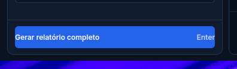
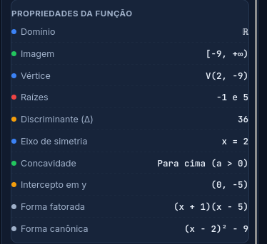
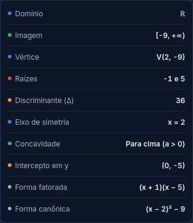
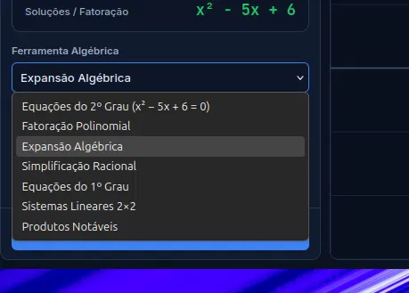
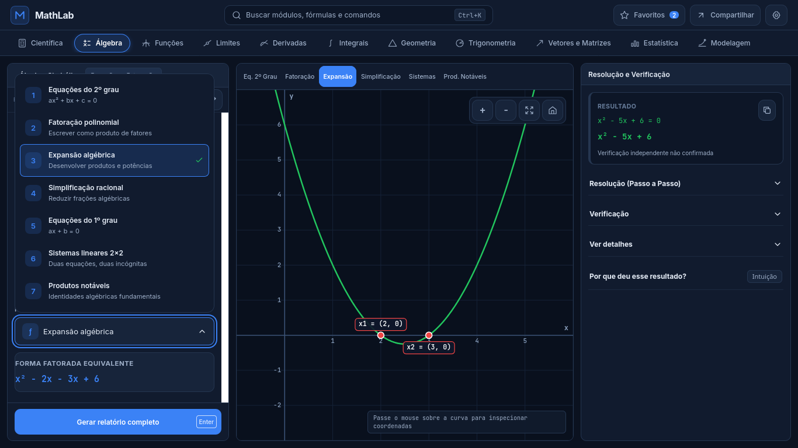
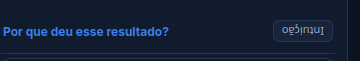

# Revisão de Trigonometria e alinhamento da interface

Revisão de 14/11/2026. Implementação local, mantendo HTML, CSS, JavaScript, Canvas e SVG. Reprodução e aceitação automatizadas no Firefox. A URL utilizada foi `http://127.0.0.1:5500/index.html`.

## Reprodução e causas

A captura inicial desta revisão é [trigonometria-antes.png](evidencias/trigonometria-antes.png). Ao abrir Trigonometria, não houve erro JavaScript. O canvas media **725 × 525 pixels lógicos**, com tamanho CSS correspondente, em DPR 1. A onda já aparecia: o commit anterior `ee1ecd8` havia implementado `ResizeObserver`, proteção para abas ocultas e dimensões lógicas. Essa solução foi reaproveitada, inclusive a separação entre tamanho CSS e resolução Retina usada em Integrais. Não foi atribuída a `canvas.width` uma falha que não estava presente no código encontrado.

| Item | Causa encontrada | Correção e comportamento final |
|---|---|---|
| T1 | O canvas vazio original já estava corrigido. Restavam janela não padronizada, extremos fixos apenas para o seno básico, ausência de assíntotas explícitas e supressão do rótulo 2π na borda. | Mantido o dimensionamento observado; janela −2π a 2π e altura baseada em A e D; curva de 3 px, eixos em π, extremos vermelhos, raízes e polos transformados. Rótulos das bordas ficam dentro do canvas. Zoom, arrasto, clique, ajuste, abas e tema foram conferidos. |
| T2 | A expressão compartilhada usava outro formato (`1 * sen(1x)`) e ignorava C e D. O cartão genérico dependia de um status de verificação que Trigonometria não produzia. Sliders chamavam o renderizador completo. | Um estado canônico em `state.trigonometria`, consultado por `obterDadosTrigonometria` e atualizado por `mudarTrigonometria`. Resultado e propriedades coerentes; campos existentes permanecem no DOM enquanto se digita. Copiar resultado, explicação, histórico e exportações foram preservados. |
| T3 | Fragmentos da fórmula eram filhos independentes de um flex com quebra; θ e uma barra eram misturados à expressão. Faltavam C e D. A largura dos campos ignorava parte do preenchimento e das bordas. | Grupos matemáticos indivisíveis; quebra só entre grupos quando o espaço termina. Ângulo em bloco separado; quatro parâmetros com cores. Campos dimensionados pelo texto **mais** preenchimento e bordas. O controle fx aparece no foco, fora da borda. |
| T4 | Regras antigas de largura mínima e conteúdo intrínseco competiam com o grid. Cabeçalho e conteúdo interno precisavam de limites explícitos. Não havia rolagem horizontal reproduzida na captura inicial em 1366 px. | Colunas com `minmax`, filhos com `min-width:0`, tabela e painéis com rolagem interna, cabeçalho adaptável. Verificação em 3 resoluções e 4 níveis de zoom nativo, nos 11 modos. |
| T5 | Ícones vinham de glifos e emoji com métricas diferentes; alturas de controles variavam entre 25, 29, 33 e 37 px; o botão principal usava `space-between`; sliders não reservavam uma coluna uniforme para rótulos. | SVG de 16 px e traço 1,75; ações/abas de 36 px, botão principal de 44 px; colunas laterais simétricas centralizam o rótulo, com Enter separado. Sliders em grade, chips e cartões consistentes. Botão longo de Limites ocupa uma linha própria. Não havia seta lateral ‹ remanescente no código encontrado. |
| T6 | Domínio, paridade, imagem e extremos eram calculados como se não existissem deslocamentos. A tabela tinha somente 8 ângulos. Valores notáveis e conferência das identidades estavam incompletos. | Família A·fn(Bx+C)+D completa; propriedades analíticas, casos constantes e inválidos; tabela com 17 ângulos; ciclo com projeções, exatos, decimais, quadrante e sinais. Conversão de unidade preserva θ. Identidades só recebem selo após conferência numérica. |

**Convenções matemáticas:** C positivo desloca a onda para a esquerda quando B é positivo; o deslocamento horizontal é −C/B, portanto negativo nesse caso. Na tangente transformada, os polos são `(π/2 + kπ − C)/B`, para B ≠ 0. A tangente não tem amplitude finita; a interface informa isso. Para A = 0 ou B = 0, não se atribui período fundamental a uma função constante. Uma tangente constante fora do domínio é inválida.

## Antes e depois por item

As imagens registram etapas reais, sem reconstruir artificialmente o estado anterior. T2 e T3 são capturas intermediárias; os valores exatos e a tabela foram completados no T6.

| Etapa | Antes | Depois |
|---|---|---|
| T1 | [Estado encontrado](evidencias/trigonometria-antes.png) | [Janela e extremos](evidencias/trigonometria-t1-depois.png) |
| T2 | [Antes do estado unificado](evidencias/trigonometria-t1-depois.png) | [Resultado coerente](evidencias/trigonometria-t2-depois.png) |
| T3 | [Fórmula antiga](evidencias/trigonometria-t2-depois.png) | [Grupos e quatro parâmetros](evidencias/trigonometria-t3-depois.png) |
| T4 | [Antes do ajuste global](evidencias/trigonometria-antes-t4.png) | [Colunas contidas](evidencias/trigonometria-t4-depois.png) |
| T5 | [Controles anteriores](evidencias/trigonometria-t4-depois.png) | [Controles padronizados](evidencias/trigonometria-t5-depois.png) |
| T6 | [Antes dos valores exatos](evidencias/trigonometria-t5-depois.png) | [Resultado final](evidencias/trigonometria-depois.png), [ciclo](evidencias/trigonometria-ciclo-depois.png), [tabela](evidencias/trigonometria-tabela-depois.png), [tangente](evidencias/trigonometria-tangente-depois.png) |

## Ajustes solicitados nas quatro capturas adicionais

**Botão do relatório:** a distribuição `space-between` prendia o texto à esquerda e o atalho à direita. O botão agora tem uma coluna central para o rótulo e duas colunas laterais iguais. O teste compara os centros geométricos do botão e do rótulo, e verifica a separação do selo Enter, em todos os modos e tamanhos testados.

Antes:



Depois:


**Lista de propriedades:** os valores ficavam encostados na borda e a divisão das colunas favorecia quebras irregulares. Agora há margem interna de 12 px, linhas de pelo menos 36 px, números tabulares, tipografia consistente e pontos coloridos alinhados à primeira linha do rótulo.

Antes:



Depois:



**Seletor de Álgebra:** a lista cinza era o popup nativo do navegador, cuja aparência não segue integralmente o CSS da página. A apresentação foi substituída por um combobox com lista azul, descrições, marca de seleção e navegação por setas, Enter, Escape e Tab. O select original continua sendo a fonte do valor e do evento de alteração; as sete ferramentas permanecem disponíveis. O popup se posiciona acima ou abaixo do controle conforme o espaço e não é cortado pelo painel rolável.

Antes:



Depois:



**Selo “Intuição” invertido:** o seletor `.layered-details[open] > summary > span:last-child` girava qualquer último span do título, incluindo texto. A rotação agora é exclusiva de `.details-chevron`, que contém apenas a seta. Abertura dos detalhes foi conferida nos 11 modos.

Antes:



Depois:


Na busca por outros detalhes pequenos, foram corrigidos também:

- Selos “Verificado” que se esticavam pela linha inteira: agora têm largura do conteúdo e fundo discreto, mantendo contraste nos dois temas.
- Coordenadas de uma curva anterior que permaneciam ao trocar de modo: o canvas limpa o ponto e o aviso ao conectar uma nova configuração.
- Assíntotas da tangente limitadas à janela inicial: agora os polos são recalculados para a janela atual depois de zoom ou arrasto.
- Rótulos numéricos cortados por largura insuficiente: a medida inclui texto, preenchimento e bordas.
- Estado genérico “Aguardando resultado válido” em cartões que já tinham resultado: a ausência de conferência independente é informada separadamente.

## Varredura dos 11 modos

Foram conferidos os controles compartilhados, botão do relatório, abas, margens, campos, ícones e painel direito em cada modo. O texto “Aguardando resultado válido” do cartão compartilhado também foi corrigido para não aparecer como status de resultados já disponíveis e ainda não verificados.

| Modo | Ocorrências corrigidas e conferidas | Antes | Depois |
|---|---|---|---|
| Científica | Controles de entrada, restaurar/aleatório, alternâncias, chips e botão principal. | [Antes](evidencias/cientifica-antes-t4.png) | [Depois](evidencias/cientifica-depois.png) |
| Álgebra | Controles compartilhados e novo seletor azul, com sete ferramentas e teclado. | [Antes](evidencias/algebra-antes-t4.png) | [Depois](evidencias/algebra-depois.png) |
| Funções | Sliders, campos, propriedades com margens e alinhamento, botão principal. | [Antes](evidencias/funcoes-antes-t4.png) | [Depois](evidencias/funcoes-depois.png) |
| Limites | Botão “lim(x→0) 1/x (Não Existe)” cortado por dividir a linha com outra demonstração; agora cada demonstração tem sua linha. | [Antes](evidencias/limites-antes-t4.png) | [Depois](evidencias/limites-depois.png) |
| Derivadas | Campos fx, ações, abas, cabeçalho e rodapé padronizados. | [Antes](evidencias/derivadas-antes-t4.png) | [Depois](evidencias/derivadas-depois.png) |
| Integrais | Reaproveitados canvas e estado existentes; ajustados ícones, campos, abas e rodapé. | [Antes](evidencias/integrais-antes-t4.png) | [Depois](evidencias/integrais-depois.png) |
| Geometria | Controles, propriedades, chips, campos e margens do painel. | [Antes](evidencias/geometria-antes-t4.png) | [Depois](evidencias/geometria-depois.png) |
| Trigonometria | T1–T6, duplicação de abas removida, quatro parâmetros e ângulo separado. | [Antes](evidencias/trigonometria-antes.png) | [Depois](evidencias/trigonometria-depois.png) |
| Vetores e Matrizes | Alternâncias, ações, campos de coordenadas e rodapé. | [Antes](evidencias/vetores-antes-t4.png) | [Depois](evidencias/vetores-depois.png) |
| Estatística | Alternâncias populacional/amostral, chips, propriedades e rodapé. | [Antes](evidencias/estatistica-antes-t4.png) | [Depois](evidencias/estatistica-depois.png) |
| Modelagem | Campo que cortava “100”, sliders, chips, propriedades e rodapé. | [Antes](evidencias/modelagem-antes-t4.png) | [Depois](evidencias/modelagem-depois.png) |

Também foram abertos e capturados: [Compartilhar](evidencias/menu-compartilhar-depois.png), [Configurações](evidencias/menu-configuracoes-depois.png), [Favoritos](evidencias/menu-favoritos-depois.png), [Atalhos](evidencias/menu-atalhos-depois.png), [Sobre](evidencias/menu-sobre-depois.png), [Estados](evidencias/menu-estados-depois.png), [Tour](evidencias/menu-tour-depois.png), [Busca](evidencias/menu-busca-depois.png) e [Estudo da função](evidencias/menu-estudo-depois.png).

## Testes e evidências

- Antes de alterar o código: `npm test` aprovou as **8 suítes existentes**.
- Depois: `npm test` aprova **9 suítes**, incluindo a nova suíte de Trigonometria, seus casos de aceitação, valores exatos, entradas inválidas, conversão e 243 combinações de parâmetros/função por referência independente.
- Firefox: casos de aceitação 1 a 10; curva e rótulos efetivamente desenhados; tangente sem segmentos cruzando polos; digitação tecla por tecla de “−0,5” e “π/6”, verificando identidade do nó e foco; conversões; clique, zoom e arrasto; troca de abas/tema; modo Normal; tabela; ciclo; menus; propriedades, seletor de Álgebra com teclado, abertura dos detalhes nos 11 modos, selo Intuição sem rotação e limpeza das coordenadas ao trocar a curva.
- Layout: **132 combinações** = 11 modos × 3 resoluções (1366×768, 1536×864, 1920×1080) × 4 níveis de zoom (90%, 100%, 110%, 125%). Foram medidos largura da página, painel direito, rodapé, posição dos botões do cabeçalho, corte de textos e alinhamento/separação do rótulo do relatório. O zoom foi aplicado pelo próprio Firefox e conferido pelo DPR; não se tratou de escala CSS.
- Nenhum erro JavaScript durante a rodada final. Isso se refere aos eventos `error` e `unhandledrejection` coletados pelo teste após carregar a página, e não a uma inspeção histórica de todas as mensagens do navegador.

Registros: [Node](evidencias/log-testes-trigonometria.txt), [Firefox](evidencias/log-firefox-trigonometria.txt), [medidas de layout](evidencias/layout-firefox-depois.json), [inventário dos controles](evidencias/varredura-depois.json) e [erros coletados](evidencias/console-firefox-depois.json).

O Live Server recarrega a página quando evidências são gravadas no projeto. Por isso, o teste salva primeiro em `/tmp/mathlab-evidencias-firefox` e copia os arquivos após terminar as interações.

## Como repetir

Em terminais separados:

```bash
# Usar o Live Server na porta 5500 ou:
python3 -m http.server 5500 --bind 127.0.0.1

# Controlador do Firefox instalado no ambiente:
geckodriver --port 4444 --allow-system-access

npm test
npm run test:firefox
```

O teste Firefox utiliza somente a biblioteca padrão do Python e o protocolo WebDriver. Não instala bibliotecas nem altera preferências do perfil pessoal. Cria um perfil temporário headless e fecha a sessão ao terminar. `MATHLAB_URL` e `MATHLAB_WEBDRIVER` permitem mudar URL/porta. Os testes Playwright anteriores continuam disponíveis, mas não foram usados como evidência desta rodada porque o pedido foi usar Firefox.

## Arquivos alterados

- `index.html`: ícones e estrutura simétrica do botão principal; versão dos assets atualizada para evitar cache antigo.
- `src/js/app.js`: modelo de Trigonometria, atualizações sem recriar os inputs, fórmula, propriedades, tabela/ciclo, seletor de Álgebra e ajustes dos estados compartilhados.
- `src/js/motor-grafico.js`: rótulos na borda, marcadores e proteção do popover de pontos sem rótulo.
- `src/css/estilos.css`: grid, alinhamento, controles, campos, propriedades e seletor azul.
- `package.json`, `tests/executar-testes.js`: comandos e inclusão da nova suíte.
- `tests/trigonometria-modulo.test.js`, `tests/interface-firefox.py`: regressões matemáticas e aceitação no navegador.
- `docs/relatorio-trigonometria-interface.md`, `docs/roteiro-validacao-humana.md`, `README.md`: relatório, roteiro manual e instruções.
- `docs/evidencias/`: capturas reais, logs e medidas JSON.

## Pendências e limites

Nenhum item T1–T6 ou ajuste das quatro capturas foi deixado sem implementação. A validação humana do roteiro ainda deve ser feita pelo responsável pela entrega; a automação não foi registrada como validação humana. O zoom e a aceitação visual desta revisão foram executados no Firefox desktop; outros navegadores e dispositivos físicos não foram homologados nesta rodada. Não há publicação ou alteração de remoto GitHub incluída no pedido.

## Commits da revisão

```text
12d7230 fix(trigonometria): completar janela e assíntotas do gráfico (T1)
859cfb4 fix(trigonometria): unificar estado e atualizar resultado sem recriar campos (T2)
21a75d6 fix(interface): agrupar fórmula trigonométrica e dimensionar campos (T3)
37df15c fix(layout): conter colunas e registrar varredura dos onze modos (T4)
904e3ff fix(interface): padronizar ícones botões e parâmetros em todos os modos (T5)
e4f6368 fix(interface): centralizar rótulo do relatório com colunas simétricas
d295663 feat(trigonometria): completar propriedades valores exatos e aceitação no Firefox (T6)
67d4acb fix(interface): alinhar propriedades e renovar seletor de Álgebra com teclado
b915fb6 fix(interface): corrigir selo invertido e detalhes ao trocar gráficos
```
